Hi there! 👋 I'm Joe, a Computer Engineering student at the University of Waterloo.
> 🚀 **Focus:** AI/ML inference systems.\
> 🛠️ **Projects:** Working with CUDA, C++, and C#.\
> ⚡ **Interests:** High-performance computing, automation workflows, AI, startups, and game dev.

 

## Currently Building

- 🚀 [**LLM-Inference-Engine**](https://github.com/joezhuo2/LLM-Inference-Engine): C++/CUDA engine with a paged KV cache, fused kernels, CUDA Graphs, and continuous batching.

## Featured Projects

- ⚔️ [**Anamnesis**](https://github.com/joezhuo2/Anamnesis): Wave-based Unity/C# RPG featuring custom projectile physics and state-driven enemy AI.
- 🔬 [**Multi-POV Research War Room**](https://github.com/joezhuo2/htv-papier-challenge): Autonomous autoresearch framework built for the HTV11 Papiers Autoresearch Challenge.
- 🛠️ [**ObjectPoolLinter (v2.0.0)**](https://www.nuget.org/packages/ObjectPoolLinter): C# Roslyn analyzer that detects heap allocations and object pool misuse in hot path code. [source](https://github.com/joezhuo2/ObjectPoolLinter)

## Other Cool Projects

- ⚡ [**CrystalOS**](https://github.com/joezhuo2/crystal-os): Personal productivity dashboard integrating Google Calendar OAuth, local Obsidian vaults, and many other features.
- 🦀 [**crawde**](https://github.com/joezhuo2/crawde): A desktop pet that monitors your Claude Code sessions and alerts you to approvals and completed tasks.
- 📈 [**tickr**](https://github.com/joezhuo2/tickr): Lightweight Rust/Tauri system tray stock ticker with a chart window behind a global hotkey.
- 🛰️ [Omniscience](https://github.com/joezhuo2/omniscience): A lightweight, open-source dynamic island styled system monitor that expands into a compact dashboard on hover.
- ⚽ [**money-makers (Microsoft hackathon entry)**](https://github.com/joezhuo2/microsoft-hackathon-inside-the-game): AI match intelligence platform generating real-time match insights.

## Other Projects
- ⚙️ [**gearshift**](https://github.com/joezhuo2/gearshift): Background workflow manager and dynamic model router for Claude Code CLI.
- 🏝️ [**islet**](https://github.com/joezhuo2/islet): Always-on-top desktop companion tracking active Claude Code CLI sessions.
- 📜 [**unity debug log viewer**](https://github.com/joezhuo2/unity-debug-log-viewer): Lightweight console utility for runtime Unity log inspection.
- ♟️ [**Clashmate**](https://github.com/joezhuo2/Clashmate): Tactical Java chess variant engine featuring unique per-piece abilities.
- 🛒 [**Supermarket Simulation**](https://github.com/joezhuo2/Supermarket-Simulation): Java simulation analyzing customer queue behavior and flow.
- 🌿 [**Wynncraft Ingredient Tracker**](https://github.com/joezhuo2/ingredient-tracker): Web analytics tool for MMORPG drop yields and route optimization.

---

