## Hi there! 👋 I'm Joe

Computer Engineering @ University of Waterloo | AI Inference & Systems
> 🚀 **Focus:** AI inference systems, Dev tools.\
> 🛠️ **Stack:** C++, CUDA, Python, C#, Java\
> ⚡ **Interests:** High-performance computing, automation workflows, AI, startups, and game dev.

## Featured Projects
- 🚀 [**LLM-Inference-Engine**](https://github.com/joezhuo2/LLM-Inference-Engine): C++/CUDA engine with a paged KV cache, fused kernels, CUDA Graphs, and continuous batching.
- 📈 [**tickr**](https://github.com/joezhuo2/tickr): Lightweight system tray stock ticker and market analyzer.
- 🔬 [**Multi-POV Research War Room**](https://github.com/joezhuo2/htv-papier-challenge): Autonomous agentic autoresearch framework.
- 🛠️ [**ObjectPoolLinter**](https://www.nuget.org/packages/ObjectPoolLinter): C# Roslyn analyzer that detects heap allocations and object pool misuse in hot path code.

<b>View More Projects (Dev Tools, Apps, Game Dev)</b>

  
#### 🛠️ Developer Tools & CLI Extensions
- 🦀 [**crawde**](https://github.com/joezhuo2/crawde): Desktop pet monitoring Claude Code CLI sessions with task completion alerts.
- 🎯 [**delegate-skills**](https://github.com/joezhuo2/delegate-skills): Subagent routing across multiple AI providers for Claude Code.
- 🔇 [**stop-yap**](https://github.com/joezhuo2/stop-yap): Claude Code plugin restricting verbosity and over-explaining.
- ❓ [**interrogate-skill**](https://github.com/joezhuo2/interrogate-skill): Interactive prompt skill extracting missing context before agent execution.- 🎨 [**visual-pass-skill**](https://github.com/joezhuo2/visual-pass-skill): Claude Code plugin that makes Claude inspect the UI it just built or changed for errors and inconsistencies.
- 📜 [**unity debug log viewer**](https://github.com/joezhuo2/unity-debug-log-viewer): Lightweight console utility for runtime Unity log inspection.

#### 📈 Applications & Systems
- 🛰️ [**omniscience**](https://github.com/joezhuo2/omniscience): Dynamic-island styled system monitor expanding into a compact dashboard.
- ⚡ [**CrystalOS**](https://github.com/joezhuo2/crystal-os): Personal productivity dashboard featuring modular workflow widgets.
- ⚽ [**money-makers**](https://github.com/joezhuo2/microsoft-hackathon-inside-the-game): AI match intelligence platform generating real-time match insights.
- 🏝️ [**islet**](https://github.com/joezhuo2/islet): Always-on-top desktop companion tracking active Claude Code CLI sessions.
- 🔬 [**elevait**](https://github.com/joezhuo2/biohacks-mcmaster): Adaptive care dashboard for ALS foot drop monitoring and gait forecasting.

#### 🎮 Game Dev & Simulations
- ⚔️ [**anamnesis**](https://github.com/joezhuo2/Anamnesis): Wave-based RPG featuring custom projectile physics and state-driven enemy AI.
- ♟️ [**clashmate**](https://github.com/joezhuo2/Clashmate): Tactical Java chess variant engine featuring unique per-piece abilities.
- 🛒 [**supermarket simulation**](https://github.com/joezhuo2/Supermarket-Simulation): Java queue simulation analyzing customer flow and wait bottlenecks.
- 🌿 [**Wynncraft ingredient tracker**](https://github.com/joezhuo2/ingredient-tracker): Web analytics tool for MMORPG drop yields and route optimization.

---

 

  

 
