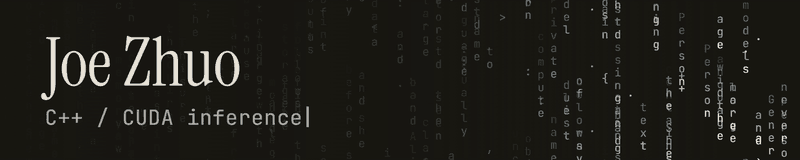
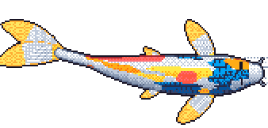

<a href="https://github.com/joezhuo2/LLM-Inference-Engine">
  <picture>
    <source media="(prefers-color-scheme: dark)" srcset="profile/banner-dark.gif" />
    <source media="(prefers-color-scheme: light)" srcset="profile/banner-light.gif" />
    
  </picture>
</a>
<i>Real tokens decoded by my inference engine, one column per sequence in the batch</i>

---

**Computer Engineering @ uWaterloo** | AI Inference & Systems

> 🚀 **Focus:** AI inference systems, static analysis, Dev tools.\
> 🛠️ **Core Stack:** C++, CUDA, Python, C#\
> 🎯 **Seeking:** 2027 SWE & AI Systems internships

 

## Featured Projects
- [**LLM-Inference-Engine**](https://github.com/joezhuo2/LLM-Inference-Engine): C++/CUDA engine that runs 1.15–1.29× faster than llama.cpp on the same weights, decoding at 93% of GPU memory bandwidth (paged KV cache, continuous batching, CUDA Graphs).
- [**tickr**](https://github.com/joezhuo2/tickr): Rust/Tauri/Svelte system tray stock ticker for Windows and macOS with a hotkey chart window.
-  [**ObjectPoolLinter**](https://www.nuget.org/packages/ObjectPoolLinter): C# Roslyn analyzer that detects heap allocations and object pool misuse in hot path code.

<b>View More Projects (Dev Tools, Apps, Game Dev)</b>

  
#### 🛠️ Developer Tools & CLI Extensions
- [**crystal-design**](https://github.com/joezhuo2/crystal-design): Component and animation library for React.
- [**crawde**](https://github.com/joezhuo2/crawde): Desktop pet monitoring Claude Code CLI sessions with task completion alerts.
- [**delegate-skills**](https://github.com/joezhuo2/delegate-skills): Subagent routing across multiple AI providers for Claude Code.
- [**stop-yap**](https://github.com/joezhuo2/stop-yap): Claude Code plugin restricting verbosity and over-explaining.
- [**interrogate-skill**](https://github.com/joezhuo2/interrogate-skill): Claude Code plugin that makes Claude ask clarifying questions before it builds.
- [**visual-pass-skill**](https://github.com/joezhuo2/visual-pass-skill): Claude Code plugin that makes Claude inspect the UI it just built or changed for errors and inconsistencies.
- [**unity debug log viewer**](https://github.com/joezhuo2/unity-debug-log-viewer): Console utility for inspecting Unity logs at runtime.

#### 📈 Applications & Systems
- [**omniscience**](https://github.com/joezhuo2/omniscience): Dynamic Island–style monitor for CPU, RAM, GPU, disk and network, no admin rights needed.
- [**CrystalOS**](https://github.com/joezhuo2/crystal-os): Personal productivity dashboard built from modular workflow widgets.
- [**money-makers**](https://github.com/joezhuo2/microsoft-hackathon-inside-the-game): Football tracking pipeline that turns raw tracking data into events, stats and key moments, replayed as a live overlay with AI analysis checked against the data.
- [**Multi-POV Research War Room**](https://github.com/joezhuo2/htv-papier-challenge): Hack the Valley 11 solo build: an autonomous agent tunes a Triton GPU kernel to 2.6× over naive under competing speed and precision goals, with code, not the model, judging every result.
- [**crystal-converter**](https://github.com/joezhuo2/crystal-converter): Utility for converting and editing files.
- [**elevait**](https://github.com/joezhuo2/biohacks-mcmaster): Adaptive care dashboard for ALS foot drop monitoring and gait forecasting. **1st place (general), BioHacks McMaster.**

#### 🎮 Game Dev & Simulations
- [**anamnesis**](https://github.com/joezhuo2/Anamnesis): Unity 6 wave-based action roguelite with custom attack patterns and a POE2-style skill tree.
- [**clashmate**](https://github.com/joezhuo2/Clashmate): Java chess variant engine where each piece has its own ability.
- [**supermarket simulation**](https://github.com/joezhuo2/Supermarket-Simulation): Java queue simulation analyzing customer flow and wait bottlenecks.
- [**Wynncraft ingredient tracker**](https://github.com/joezhuo2/ingredient-tracker): Web analytics tool for MMORPG drop yields and route optimization.

